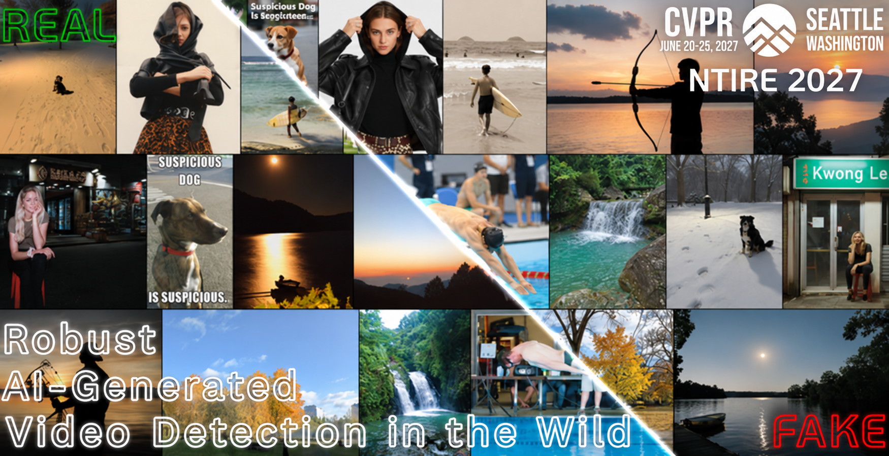

# NTIRE 2027 Challenge on Robust AI-Generated Video Detection in the Wild

Can your detector spot an AI-generated video after it has been compressed, resized, and shared online?

Join our **Robust AI-Generated Video Detection in the Wild** challenge, planned for **CVPR–NTIRE 2027**. We are preparing a **large-scale dataset of real and AI-generated videos** spanning diverse scenes, a range of modern video generators, and a wide variety of real-world distortions.

Building on our [NTIRE 2026 image detection challenge](https://github.com/msu-video-group/NTIRE-2026-DeepFake-Detection), this edition brings the robustness question to video. Participants can explore whether motion and other cues across frames help detectors generalize to new generators and stay reliable after post-processing.

> **The challenge is in preparation.** Star and watch this repository for registration, dataset access, and submission updates.

## Challenge Task

Develop a detector that assigns each clip a score indicating how likely it is to be AI-generated. The task is to distinguish real camera footage from AI-generated video across a broad range of scenes and subjects. Methods can use individual frames, temporal cues such as motion and consistency across frames, or a combination of both.

## Dataset

| Feature | What to expect |
| --- | --- |
| Scale | A large collection of real and AI-generated video clips |
| Content | Diverse scenes, subjects, and types of motion |
| Generators | A range of modern video generation models |
| Distortions | A broad range of post-processing operations that mimic how videos are edited, uploaded, and shared, such as recompression, resizing, and frame-rate changes |

## Evaluation

The evaluation will focus on three questions:

- **Clean video.** How well does the detector distinguish real from AI-generated clips before challenge distortions are applied?
- **Distorted video.** How well does it hold up after real-world post-processing?
- **Unseen generators.** How well does it generalize to generators held out from the challenge training data?

The final metrics, evaluation protocol, and submission format will be announced here.

## Timeline

Registration and challenge dates will be announced here. For an idea of the competition stages, see the [NTIRE 2026 workshop schedule](https://www.cvlai.net/ntire/2026/).

## Previous Edition

### CVPR–NTIRE 2026: Robust AI-Generated Image Detection in the Wild

The 2026 challenge benchmarked detection on **294,500 images** using **42 image generators** and **36 transformations**. It attracted **511 registered participants**, and **20 teams** submitted valid final solutions. The challenge report covers the dataset, evaluation protocol, and teams’ approaches.

[Challenge repository](https://github.com/msu-video-group/NTIRE-2026-DeepFake-Detection) · [Challenge report](https://arxiv.org/abs/2604.11487)

## Get Ready to Participate

**Bring your next video detection method to NTIRE 2027.** In the meantime, explore the 2026 challenge results for approaches to handling post-processing and unseen generators.
